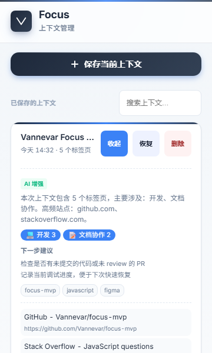
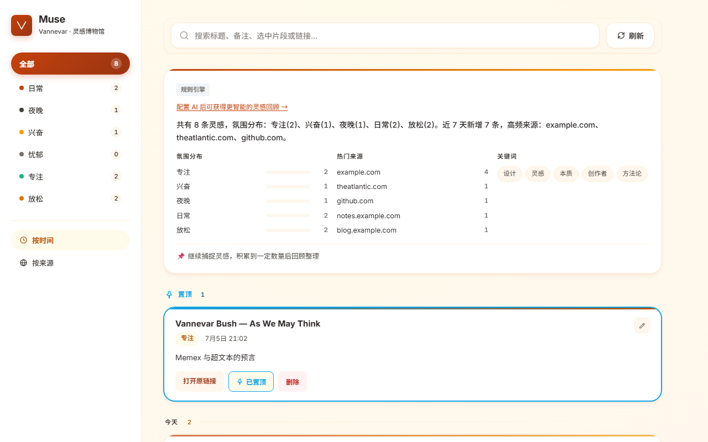
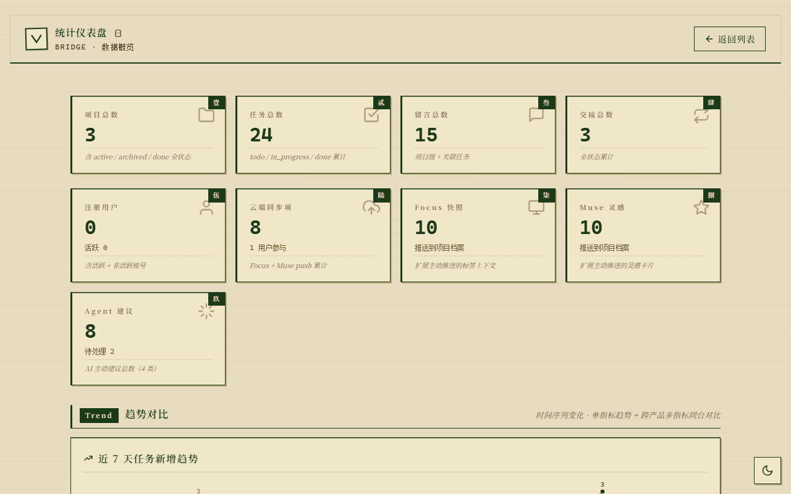

# Vannevar

<p align="right"><a href="README.md">中文</a> · English</p>

[](https://github.com/1273984347/vannevar/actions/workflows/ci.yml)
[](LICENSE)
[](https://github.com/1273984347/vannevar/releases)
[](products/focus-mvp/manifest.json)
[](products/bridge-mvp/requirements.txt)
[](products/focus-mvp/manifest.json)

> Put the right information in front of you, at the right moment.

Vannevar is a **context-management product family**, named in tribute to the Memex concept proposed by Vannevar Bush in the 1945 essay *As We May Think*. It does not "store more things" for you — it keeps **your current work, inspirations, and collaboration flowing without interruption**.

One product family covers three stages of the same context lifecycle:

| Capture | Organize | Hand off |
|---|---|---|
| **Focus** | **Muse** | **Bridge** |

---

## Why

We don't lack storage tools — we lack **continuity of context**. Information quietly leaks away in the three most common shapes:

| Shape | What it looks like | Root cause | Vannevar's answer |
|---|---|---|---|
| **Broken work sessions** | 20 tabs open; after a reboot they're all gone — tabs, search terms, scroll positions vanish together | The session lives only inside the browser; it is never "frozen" | **Focus**: freeze tabs + titles + URLs + selected text into a snapshot, restore with one click; AI auto-tags "deep focus / multi-track / urgent" |
| **Sunken inspirations** | A quote, a color palette, a song — by the time you want them, you can't scroll any further; favorites become a junkyard | The organizing dimension is wrong — people don't remember "folder paths", they remember "how it felt" | **Muse**: organize inspirations by **mood** instead of folders; content of the same mood naturally clusters; the dashboard reviews by day |
| **Handoff gaps** | When a nonprofit project shifts shifts, 30% of the outgoing volunteer's knowledge is never written down; newcomers start from scratch | Handoff depends on "writing a summary" — an extra chore that doesn't happen, so the info is lost | **Bridge**: the board accumulates tasks and messages; AI generates a handoff summary from tasks/messages/history in one click; scan a QR code to pick up |

All three lines share one kernel: **local-first storage, a unified AI degradation strategy, a shared design system, and the Context Card exchange format**.

---

## The three products at a glance

| Product | Form | Typical scenario | Core capabilities | Directory |
|---|---|---|---|---|
| **Focus** | Chrome MV3 extension | Deep work, multi-track research, interruption recovery | Tab snapshots & restore, AI context tags, local encrypted sync to Bridge | [`products/focus-mvp/`](products/focus-mvp/) |
| **Muse** | Chrome MV3 extension | Inspiration capture, material archiving, creative review | Selection capture, mood tags & groups, dashboard timeline, media metadata, end-to-end encrypted sync | [`products/muse-mvp/`](products/muse-mvp/) |
| **Bridge** | FastAPI web service | Nonprofit team collaboration, volunteer handoff, relay | Project board & tasks, Basic Auth + RBAC, AI handoff summaries, SSE live updates, QR-code relay | [`products/bridge-mvp/`](products/bridge-mvp/) |

<table>
  <tr>
    <td align="center" width="25%"><br><b>Focus</b> · snapshot / restore / AI tags</td>
    <td align="center" width="37.5%"><br><b>Muse</b> · mood tags / timeline review</td>
    <td align="center" width="37.5%"><br><b>Bridge</b> · board / handoff / stats</td>
  </tr>
</table>

Technical shapes at a glance:

- **Focus / Muse**: vanilla JavaScript (no frontend framework), Chrome Manifest V3, Service Worker + sql.js (SQLite WASM) + `chrome.storage.local`.
- **Bridge**: FastAPI + SQLAlchemy + SQLite (WAL mode + rolling backups) + Jinja2 + SSE; switch to PostgreSQL via `BRIDGE_DATABASE_URL`.

---

## Quick start

### Focus / Muse (browser extensions)

No build step, no `npm install` — both are pure vanilla JS. Load them as **unpacked extensions**:

1. Open `chrome://extensions/` (Edge: `edge://extensions/`).
2. Turn on **Developer mode** (top right).
3. Click **Load unpacked**.
4. Pick the product directory in this repo:
   - Focus → `products/focus-mvp`
   - Muse → `products/muse-mvp`
5. Pin them to the toolbar. Focus shortcuts default to `Alt+Shift+S` (save context) and `Alt+Shift+R` (restore the latest one).

First-run tip: open the extension's **Options page** and confirm AI enhancement shows "not configured / local rule engine" — everything works without any API key (see next section).

> The extensions only request the minimal permissions they need (`tabs`/`storage`/`activeTab`/`windows`/`alarms`/`notifications`); `host_permissions` is empty, and nothing beyond the pages you act on is read.

### Bridge (web service)

**Windows / PowerShell**

```powershell
cd products/bridge-mvp
python -m pip install -r requirements.txt
$env:BRIDGE_JWT_SECRET = python -c "import secrets; print(secrets.token_hex(32))"
$env:BRIDGE_ADMIN_PASS = "change-to-your-password"
python main.py
```

**Linux / macOS**

```bash
cd products/bridge-mvp
python3 -m pip install -r requirements.txt
export BRIDGE_JWT_SECRET="$(python3 -c 'import secrets; print(secrets.token_hex(32))')"
export BRIDGE_ADMIN_PASS="change-to-your-password"
python3 main.py
```

> On Windows, if only the Python Launcher is available (common), replace `python` with `py`, e.g. `py -m pip install -r requirements.txt`.

Once started:

| Item | Value |
|---|---|
| Admin console | <http://127.0.0.1:8000/> |
| Username | `admin` (override with `BRIDGE_ADMIN_USER`) |
| Password | Set via `BRIDGE_ADMIN_PASS` |
| Health check | <http://127.0.0.1:8000/health> → `{"ok": true}` |

**Two required environment variables**: in production mode (i.e. `BRIDGE_DEBUG=1` is not set), the service **refuses to start** unless `BRIDGE_JWT_SECRET` is set to a strong key, and it also **refuses to start** if `BRIDGE_ADMIN_PASS` is missing or still the built-in weak password. These are intentional secure defaults — do not bypass them.

For local debugging you can set `BRIDGE_DEBUG=1`: the JWT secret and admin password are then generated randomly and printed to stderr, sparing you the manual setup.

---

## AI enhancement & graceful degradation

All three products share **one degradation chain**, designed around one principle: **AI is an optional enhancement, never a dependency**.

```
User triggers an AI feature
      │
      ├─ OpenAI-compatible API configured? ──yes──▶ call it (30s timeout cap)
      │                                             │
      │                                       success ─┴─ failure/timeout
      │                                         │              │
      │                                     return result    degrade ↓
      └─ not configured ──────────────────────────────────────▶ local rule engine
                                                               (zero external dependencies)
```

- **Focus / Muse**: fill in the API Base URL, API Key and model name in the "AI enhancement (optional)" area of the extension **Options page**. The API Key is stored only in local `chrome.storage.local` and never uploaded to any server; without a key the built-in rule engine is used (Muse's mood tagging is frequency-based statistics, not model recommendations).
- **Bridge**: configured via environment variables.

| Variable | Purpose | Example |
|---|---|---|
| `BRIDGE_AI_BASE_URL` | OpenAI-compatible endpoint (full path required) | `https://api.openai.com/v1/chat/completions` |
| `BRIDGE_AI_API_KEY` | API key | `sk-…` |
| `BRIDGE_AI_MODEL` | Model name, default `gpt-4o-mini` | `gpt-4o-mini` |
| `BRIDGE_AI_DEMO_MODE` | Demo mode: skip real calls and return preset results | `1` |

Without any configuration, Bridge's handoff summaries, status suggestions and chat assistant still work — via the built-in rule engine.

---

## Architecture & data flow

```
   ┌────────────────────┐        ┌────────────────────┐
   │  Focus (MV3 ext.)  │        │  Muse (MV3 ext.)   │
   │  Service Worker    │        │  Service Worker    │
   │  sql.js (SQLite)   │        │  sql.js (SQLite)   │
   │  chrome.storage    │        │  chrome.storage    │
   └─────────┬──────────┘        └─────────┬──────────┘    local-first
             │                                │         user context stays on-device
             │  POST /api/sync/push          │
             │  GET  /api/sync/pull?app=…    │
             └───────────────┬────────────────┘
                             │  HTTP(S) + Bearer / CSRF
                             ▼
                ┌──────────────────────────────┐
                │      Bridge (FastAPI)        │
                │  sync gateway · LWW merge    │
                │  projects/tasks/handoffs     │
                │  RBAC · CSRF · SSE           │
                └──────────────┬───────────────┘
                               │ SQLAlchemy ORM
                               ▼
        ┌──────────────────────────────────────────┐
        │  SQLite (WAL + rolling backups)          │
        │  or PostgreSQL (BRIDGE_DATABASE_URL)     │
        └──────────────────────────────────────────┘

   Shared layer: shared/vannevar-brand.css (design tokens)
                 shared/vannevar-context-card.js (.vcf Context Card format)
                 products/*/shared/vannevar-shared.js
```

Key conventions:

| Topic | Convention |
|---|---|
| Sync direction | Extensions `push` up + `pull` down, bidirectional; `app=focus` / `app=muse` distinguish sources |
| Conflict resolution | **LWW (Last-Write-Wins)**, judged by each record's own `updated_at` |
| Extension-side storage | `chrome.storage.local` + sql.js (SQLite WASM) local database |
| Server-side storage | SQLite in WAL mode + rolling backups; `BRIDGE_DATABASE_URL` switches to PostgreSQL |
| Exchange format | **Context Card (`.vcf`)** — the unified JSON format for context items across the three products |

### End-to-end encryption (extension side)

Sync data from Focus and Muse is encrypted before it ever leaves the browser:

- Algorithm: **AES-GCM-256**
- Key derivation: **PBKDF2-SHA256, 100,000 iterations** (random salt, reused fixed)
- The derived `CryptoKey` is **non-extractable** and exists only in memory
- **The user's passphrase is never written to disk and never uploaded**; the server only ever sees ciphertext, nonces and the salt

Bridge therefore cannot read un-decrypted upstream content; a forgotten passphrase means unrecoverable data (a deliberate trade-off, not a defect).

> Muse's sync used to be plaintext upload, and its push requests lacked the `X-CSRF-Token` header that Bridge's write endpoints enforce (a guaranteed 403 in production). Both are fixed — Muse now rides the same encrypted pipeline as Focus.

### Cross-device decryption

The encryption logic is provided uniformly by the shared layer `shared/vannevar-crypto.js` (Focus and Muse use the same implementation; copy consistency is enforced by the `scripts/check_shared_sync.py` gate).

- **The PBKDF2 salt is a public parameter, not a secret**: it syncs to Bridge with the crypto profile via `GET/PUT /api/auth/me/crypto-profile`, letting other devices derive the same key.
- **The passphrase never touches the cloud, never touches disk**: the profile also stores a verification ciphertext, used on another device to verify the passphrase matches.
- So on device B, entering **the same passphrase** decrypts what device A pushed; a mismatching passphrase is rejected explicitly instead of producing a pile of undecryptable data.

---

## Security model

| Layer | Mechanism |
|---|---|
| Bridge admin entry | HTTP Basic Auth; both username and password compared with `secrets.compare_digest` (constant time) |
| Bridge write operations | CSRF double-submit: random token generated at startup → Cookie + `X-CSRF-Token` header verification; `X-Requested-With` header required |
| Bridge resource authorization | RBAC + resource-ownership checks, preventing cross-tenant access to others' projects (IDOR protection) |
| Bridge response headers | Content-Security-Policy and other security headers; long-lived caching for static assets in production |
| Volunteer QR relay | `qr_token` credential + failure rate limiting + constant-time comparison; SSE endpoints enforce authentication (`qr_token` or admin Basic Auth) |
| Extension URL handling | URL scheme whitelist — only `http:` / `https:` allowed; `javascript:` / `data:` / browser-internal schemes explicitly excluded |
| Extension rendering | Rich text always goes through HTML escaping, preventing XSS |
| Extension permissions | `host_permissions` empty; `activeTab` requested on demand; CSP restricts script sources to `'self'` |
| Local data | Extension-side SQLite lives in `chrome.storage.local`; sync content of **both Focus and Muse** is end-to-end encrypted (see above) |
| Crypto profile | The PBKDF2 salt (a public parameter, not a secret) syncs via `/api/auth/me/crypto-profile` so other devices can derive the same key; passphrase and derived keys never appear server-side |
| Encryption boundary | End-to-end encryption covers **data sync** (`/api/sync/*`). "Push to a Bridge project archive" (`/api/projects/{id}/context-*`) is **not encrypted** — Bridge needs titles, links and summaries to generate handoff summaries and statistics charts |
| Keys & passphrases | Never persisted (only `chrome.storage.local` / environment variables); no secrets are committed to the repository |

Found an issue? Please report it privately following [SECURITY.md](SECURITY.md) — do not open a public issue.

---

## Development & testing

### Requirements

| Component | Version | Used for |
|---|---|---|
| Python | 3.12 | Bridge service and tests |
| Node.js | 24 | Extension unit tests (`node:test`) |
| Chrome | 102+ | Running the MV3 extensions |

### Test commands and current baseline

```bash
# Bridge: full unit/integration test suite (e2e excluded)
cd products/bridge-mvp
python -m pip install -r requirements.txt        # runtime dependencies
python -m pip install -r requirements-dev.txt    # test dependencies: pytest lives here — required
py -m pytest tests/ -q --ignore=tests/e2e
# Baseline: 449 passed / 9 skipped / 0 failed (grows with new features)

# Focus: end-to-end encryption
cd products/focus-mvp
node tests/test_crypto.mjs
# Result: 16 passed / 0 failed

# Focus: sync-pipeline encryption
node --import ./tests/loader.mjs tests/test_sync_crypto.mjs
# Result: 14 passed / 0 failed

# Muse: end-to-end encryption
cd products/muse-mvp
node tests/test_crypto.mjs
# Result: 24 passed / 0 failed (no SQLite WASM touched, no loader needed)

# Muse: sync-pipeline encryption
node --import ./tests/loader.mjs tests/test_sync_crypto.mjs
# Result: 16 passed / 0 failed

# Muse: media session
node --import ./tests/loader.mjs tests/test_media_session.mjs
# Result: 18 passed / 0 failed
```

> Muse's tests depend on the mock-loading hook provided by `tests/loader.mjs` — the `--import` flag is **mandatory**, otherwise most cases fail for lack of mocks.

Bridge's pytest uses an in-memory database (`BRIDGE_DATABASE_URL` defaults to `sqlite:///:memory:` in `tests/conftest.py`) and **will not pollute** the local `bridge_mvp.db`.

### Code checks

The repo deliberately has no standalone linter toolchain; verification relies on runtime checks:

```bash
# JavaScript syntax check
node --check products/focus-mvp/background.js

# Python syntax check
python -m py_compile products/bridge-mvp/main.py
```

> On Windows, if `python` points to the Microsoft Store placeholder, use the Python Launcher instead: `py -m py_compile ...`, `py -m pytest ...`.

### One-command QA

The repo ships a chained QA pipeline bundling packaging, integrity, contrast and link checks into a single command:

```bash
python scripts/qa_all.py              # full run (no stress test)
python scripts/qa_all.py --full       # include storage stress test
python scripts/qa_all.py --only links # run a single stage
```

Current status: **6/6 passing** (`shared_sync` / `pack_mvps` / `pack_final` / `verify_loading` / `contrast` / `links`).

`shared_sync` is the shared-layer copy-consistency gate: it verifies that `shared/vannevar-crypto.js` and the copies inside the two product directories are **byte-identical** (any drift blocks the run), while honestly reporting historical legacy drift of design tokens and Bridge-side runtime copies (non-blocking, left for a dedicated future batch).

Packaging artifacts are written to `dist/` inside the repo (that directory is gitignored and never committed).

---

## Project structure

```
Vannevar/
├── products/
│   ├── focus-mvp/          # Focus · Chrome MV3 extension (capture)
│   │   ├── background.js   #   Service Worker
│   │   ├── crypto.js       #   E2E encryption (thin wrapper; core in shared/vannevar-crypto.js)
│   │   ├── crypto-profile.js # crypto-profile sync (cross-device decryption)
│   │   ├── db.js           #   sql.js local database
│   │   ├── sync.js         #   push/pull sync with Bridge
│   │   ├── options.html    #   options page (AI enhancement etc.)
│   │   ├── lib/            #   third-party SQL.js WASM runtime + shared-layer copies
│   │   └── tests/          #   node:test cases
│   ├── muse-mvp/           # Muse · Chrome MV3 extension (organize)
│   │   ├── core/           #   muse.js / db.js / sync.js / ai*.js / crypto*.js
│   │   ├── dashboard/      #   dashboard timeline review
│   │   ├── popup/          #   extension popup
│   │   ├── options/        #   options page
│   │   └── tests/          #   node:test cases
│   └── bridge-mvp/         # Bridge · FastAPI service (handoff)
│       ├── main.py         #   application entry
│       ├── auth.py         #   Basic Auth / CSRF / JWT
│       ├── ai.py           #   AI enhancement & degradation
│       ├── backup.py       #   rolling backups & recovery
│       ├── models.py       #   SQLAlchemy models
│       ├── routers/        #   projects / tasks / events / sync / …
│       ├── templates/      #   Jinja2 templates
│       ├── static/         #   static assets
│       └── tests/          #   pytest cases
├── shared/                 # shared layer for the three products
│   ├── vannevar-brand.css  #   design tokens
│   ├── vannevar-context-card.js  # .vcf Context Card format
│   ├── vannevar-crypto.js  #   end-to-end encryption core (shared by Focus / Muse)
│   ├── media/              #   brand posters and demo video
│   └── privacy-policy.html #   privacy policy page
├── demo/                   # demo materials
├── docs/                   # user guide, deploy guide, OpenAPI, phase plans
│   └── opensource/         #   open-source release process reports
├── tech/                   # technical specs for the three products
├── assets/                 # one-pagers, competitor matrix, etc.
├── diagrams/               # architecture diagrams (HTML sources + PNG exports)
├── screenshots/            # product screenshots
├── scripts/                # packaging, screenshot, link and contrast checkers, one-command QA
├── QUICKSTART.md           # 30-second quick start
├── LOADING-GUIDE.md        # extension loading & local verification guide
├── LICENSE / NOTICE / CONTRIBUTING.md / CODE_OF_CONDUCT.md
├── SECURITY.md / CHANGELOG.md / AGENTS.md
└── .editorconfig / .gitattributes
```

Code size (measured, source files per product directory): focus-mvp 37 files / 10,312 lines; muse-mvp 45 files / 13,935 lines; bridge-mvp 63 files / 31,554 lines — 145 files / 55,801 lines in total.

---

## Contributing

Contributions are welcome. See **[CONTRIBUTING.md](CONTRIBUTING.md)** for process, environment setup and commit conventions, and **[CODE_OF_CONDUCT.md](CODE_OF_CONDUCT.md)** for community agreements.

Where the project is heading is tracked in the public **[roadmap](docs/roadmap.md)** (Now / Next / Later); swap experiences and ideas in **[Discussions](https://github.com/1273984347/vannevar/discussions)**, or file product feedback via the [feedback template](https://github.com/1273984347/vannevar/issues/new?template=feedback.yml).

Repository working conventions for AI agents and collaborators are written in **[AGENTS.md](AGENTS.md)**.

To understand "why it's designed this way" — the reasoning, **costs** and blast radius of every technical trade-off — see **[docs/architecture-decisions.md](docs/architecture-decisions.md)** (architecture decision records). When changing an existing decision, append to its "decision change log" instead of rewriting history.

---

## License

This project is released under the **MIT License** — see [LICENSE](LICENSE).

Attribution for third-party components (the SQLite WASM runtimes under each product's `lib/` directory) and ownership notes for original brand assets are in **[NOTICE](NOTICE)**.

---

## Acknowledgments

- **Vannevar Bush** (1890–1974), the 1945 essay *As We May Think*, and the **Memex** concept — the name and the starting point of this project.
- Everyone who asked questions, filed bugs and contributed documentation for Focus, Muse and Bridge.

This project began as an independent product-creation exercise: starting from the real pain of "context keeps getting lost", three tools were written from day one to the standard of **long-term usability, ready to be handed to someone else** — which is why it is released today as a complete open-source project.
